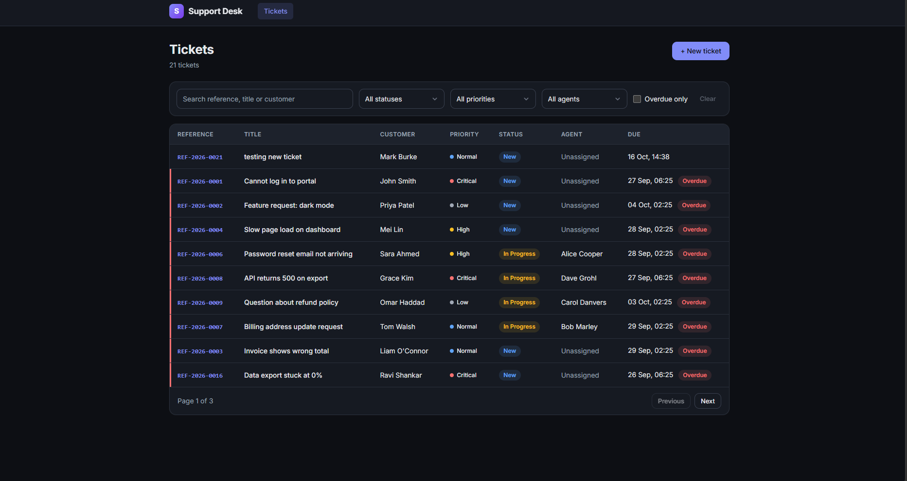

# Support Desk

A simple support ticketing tool: log customer issues, assign them to agents, and track them through to resolution with due dates and overdue tracking.



## Tech stack

- **Backend:** ASP.NET Core Web API (.NET 9), controller-based
- **Data:** EF Core 9 (code-first migrations), SQL Server (LocalDB for local development)
- **Frontend:** Angular 22 (standalone components, signals, Reactive Forms)

## Getting started

### Prerequisites

- [.NET 9 SDK](https://dotnet.microsoft.com/download)
- SQL Server LocalDB (included with Visual Studio, or install SQL Server Express)
- `dotnet-ef` tool: `dotnet tool install --global dotnet-ef`
- [Node.js](https://nodejs.org/) LTS and npm

### Backend

```bash
cd SupportDesk.Api
dotnet restore
dotnet ef database update
dotnet run
```

- The API runs on `http://localhost:5105` (`https://localhost:7292` with the `https` profile; see `Properties/launchSettings.json`).
- `dotnet ef database update` creates the `SupportDeskDb` LocalDB database and applies all migrations. No separate database server setup is needed on Windows.
- Sample data (5 agents, 20 tickets across every status and priority, several overdue) is seeded on first start by `Data/DbSeeder.cs`. Seeding is skipped if agents already exist, so restarts don't duplicate rows.
- Example requests are in `SupportDesk.Api/SupportDesk.Api.http` (VS Code REST Client extension or Visual Studio 2022).

### Frontend

```bash
cd SupportDesk.Web
npm install
npm start
```

Open `http://localhost:4200`.

### Configuration

| Setting | Location | Default |
|---|---|---|
| Database connection | `SupportDesk.Api/appsettings.json` → `ConnectionStrings:DefaultConnection` | `(localdb)\mssqllocaldb`, database `SupportDeskDb` |
| Allowed CORS origins | `SupportDesk.Api/appsettings.json` → `Cors:AllowedOrigins` | `http://localhost:4200` |
| API base URL (frontend) | `SupportDesk.Web/src/app/api-config.ts` | `http://localhost:5105/api` |

The frontend expects the API on the `http` launch profile (the default for `dotnet run`). HTTPS redirection is only enabled outside the Development environment.

## Business rules

All rules are enforced by the API. The frontend mirrors some of them (for example, only showing valid status actions) for a better experience, but never relies on that for correctness. Code that implements a rule is tagged with its ID, e.g. `// BR-3`.

| ID | Rule | Implemented in |
|---|---|---|
| BR-1 | Due date = creation date + offset by priority: Critical 4 h, High 1 day, Normal 3 days, Low 7 days. If priority changes on an open ticket, the due date is recalculated from the **original** creation date. | `TicketRulesService.CalculateDueDate`, `TicketService.UpdateTicketAsync` |
| BR-2 | Allowed status transitions: New → In Progress, In Progress → Resolved, Resolved → Closed, Resolved → In Progress (reopen). Any other transition is rejected with a reason. | `TicketRulesService.IsValidTransition` |
| BR-3 | A ticket can only move to In Progress when an active agent is assigned. | `TicketService.ChangeStatusAsync` |
| BR-4 | Inactive agents cannot be assigned to tickets. | `TicketService.AssignAgentAsync` |
| BR-5 | Closed tickets are read-only: no edits, status changes, comments or reassignment. | `TicketService` (update, status, assign, comment) |
| BR-6 | Resolved and closed dates are set by the system on transition and are never accepted from the client. | `TicketService.ChangeStatusAsync` |
| BR-7 | A ticket is overdue when its due date has passed and it is not Resolved or Closed. | `Ticket.IsOverdue` (computed, not stored) |

`TicketRulesService` holds the rules that need no database access (BR-1, BR-2). Keeping them as pure functions makes them easy to unit test without mocking the database. Rules that depend on stored state (BR-3 to BR-6) live in the services that load that state.

## API

Base URL: `/api`

### Tickets

| Method | Path | Description |
|---|---|---|
| GET | `/tickets` | List tickets. Query: `search`, `status`, `priority`, `agentId`, `overdueOnly`, `page` (default 1), `pageSize` (default 20) |
| GET | `/tickets/{id}` | Get a ticket with its comments |
| POST | `/tickets` | Create a ticket |
| PUT | `/tickets/{id}` | Update title, description, customer details or priority |
| DELETE | `/tickets/{id}` | Delete a ticket |
| PATCH | `/tickets/{id}/status` | Change status (`{ "newStatus": 1 }`) |
| PATCH | `/tickets/{id}/assign` | Assign or unassign an agent (`{ "agentId": 2 }` or `null`) |
| POST | `/tickets/{id}/comments` | Add a comment |

### Agents

| Method | Path | Description |
|---|---|---|
| GET | `/agents` | List agents. Query: `search` |
| GET | `/agents/{id}` | Get an agent |
| POST | `/agents` | Create an agent |
| PUT | `/agents/{id}` | Update an agent |
| DELETE | `/agents/{id}` | Deactivate an agent (see below) |
| DELETE | `/agents/{id}/hard` | Permanently delete an agent |

### Errors

Errors use the standard [ProblemDetails](https://datatracker.ietf.org/doc/html/rfc9457) format:

- **Validation (400):** `errors` maps each field to its messages.
- **Business rule violation (400):** `title` names the rule (e.g. `Invalid status transition`), `detail` explains it.
- **Not found (404), duplicate value (409), unexpected error (500):** `title` and `detail`. Stack traces and database errors are logged server-side and never returned to the client.

## Design notes

**Dedicated status and assignment endpoints.** Status changes go through `PATCH /tickets/{id}/status` rather than the general update endpoint, so BR-2 and BR-3 have a single entry point and cannot be bypassed by editing `status` directly. Agent assignment has its own endpoint for the same reason (BR-4).

**Expected failures are results, not exceptions.** Services return result enums (e.g. `ChangeTicketStatusResult.InvalidTransition`) that controllers map to ProblemDetails responses. Exceptions are reserved for unexpected failures, which a global exception handler turns into a generic 409 or 500.

**DTOs at the boundary.** Controllers accept and return DTOs only; EF entities are never exposed. Client-supplied DTOs have no fields for system-managed values (reference, due date, resolved/closed dates).

### Behaviour not covered by the rules above

- **Deactivating an agent** (`DELETE /agents/{id}`) handles their tickets by status:
  - New: unassigned.
  - In Progress: deactivation is blocked until the tickets are reassigned, since moving them back to New is not an allowed transition.
  - Resolved: closed.
  - Closed: unchanged.
- **Reopening** a ticket (Resolved → In Progress) clears its resolved date.
- **Reassignment** is blocked on closed tickets, as part of BR-5.
- **Deleting** a closed ticket is disabled in the UI.
- `PUT /agents/{id}` can reactivate an agent but not deactivate one; deactivation always goes through the workflow above.

## Known limitations and roadmap

- Automated tests: unit tests for `TicketRulesService` (due dates, status transitions) and component tests for the ticket form and list.
- Ticket reference generation is not safe under concurrent creates. The unique index on `Reference` rejects a duplicate (returned as 409) rather than creating one, but a database sequence or a retry on conflict would remove the failure.
- List filters are not reflected in the URL, so refreshing or sharing the page loses them.
- Configuration such as the frontend API URL is hard-coded; Angular environment files would allow per-environment builds.
- A list request still in flight is not cancelled when filters change; `switchMap` on the filter stream would guarantee only the latest result is shown.
- No authentication or authorisation.
